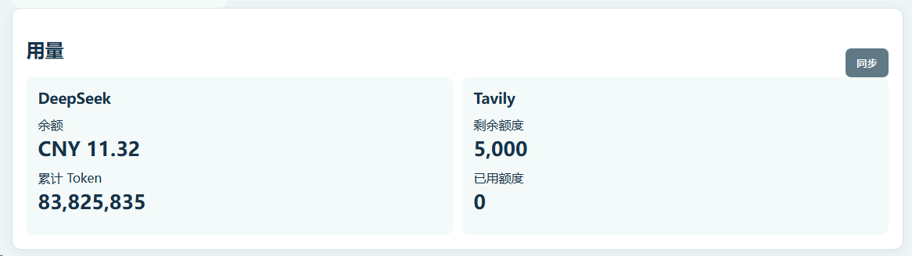
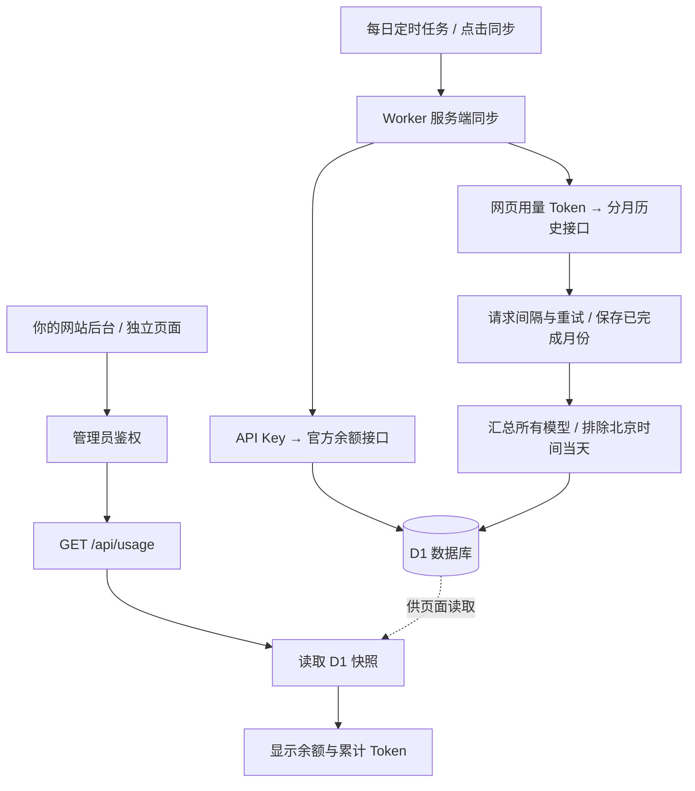

# DeepSeek Usage Widget

把 **DeepSeek 账户余额和累计 Token 用量放到自己的网站后台**。

基于 Cloudflare Workers + D1，提供可直接部署的极简页面和接入示例。每天更新一次；Token 汇总截至北京时间昨天的历史数据，排除当天，覆盖接口返回的所有模型。

[](https://github.com/TySchip/deepseek-usage-widget/actions/workflows/ci.yml)
[](LICENSE)

## 实际效果



这是维护者提供的实际网站接入截图。图中的 Tavily 为原网站已有组件；本仓库只提供 DeepSeek 部分。页面数字是截图时的快照，不是当前公开查询结果。

## 你会得到什么

- 一个只显示余额、累计 Token 和“同步”按钮的页面。
- `GET /api/usage`：读取已保存的统计快照。
- `POST /api/sync`：手动同步、首次按月补齐历史。
- 每日定时更新；页面浏览不会持续请求 DeepSeek。
- 分批同步、断点续传、请求间隔和临时异常重试。
- 管理员鉴权；DeepSeek 凭据保存在服务端 Secret，不下发浏览器。

## 工作流程



浏览器只访问你自己的服务端。余额与历史用量使用两种不同的凭据：

| 凭据 | 用途 | 保存位置 |
| --- | --- | --- |
| `DEEPSEEK_API_KEY` | 官方余额接口 | Worker Secret |
| `DEEPSEEK_USAGE_TOKEN` | DeepSeek 网页历史用量接口 | Worker Secret |
| `ADMIN_TOKEN` | 保护本项目的查询和同步接口 | Worker Secret；访问者在组件内登录 |

**API Key 和网页用量 Token 必须来自同一个 DeepSeek 账户。** 本项目无法通过这两个接口自动交叉核验账户身份。

## 从零开始部署

下面的命令在 Windows PowerShell、macOS Terminal 和 Linux Shell 中均可逐条执行。Windows 如果提示禁止运行 `npm.ps1`，将命令中的 `npm` / `npx` 改为 `npm.cmd` / `npx.cmd` 即可，无需修改系统执行策略。

### 1. 准备环境并下载项目

准备 [Node.js 24 或更高版本](https://nodejs.org/)、[Git](https://git-scm.com/downloads) 和一个 [Cloudflare 账户](https://dash.cloudflare.com/)。

```bash
git clone https://github.com/TySchip/deepseek-usage-widget.git
cd deepseek-usage-widget
npm ci
npx wrangler login
```

最后一条命令会打开浏览器，由你登录并授权 Cloudflare。Cloudflare 登录凭据与下面的 `ADMIN_TOKEN` 是两回事。

### 2. 创建数据库

```bash
npx wrangler d1 create deepseek-usage-widget-db
```

终端会返回数据库信息。打开项目根目录的 `wrangler.jsonc`，把：

```json
"database_id": "REPLACE_WITH_YOUR_D1_DATABASE_ID"
```

替换成刚创建的数据库 ID。保留 `binding: "DB"`。如果修改了数据库名称，请同时修改 `database_name` 和下面初始化命令中的名称。

初始化云端表结构：

```bash
npx wrangler d1 execute deepseek-usage-widget-db --remote --file schema.sql
```

这个 SQL 只创建 `settings` 表，不会清空已有数据，可以重复执行。建议为本组件使用单独的数据库。

### 3. 先部署页面

```bash
npm run deploy
```

记下输出的 `https://deepseek-usage-widget.<你的子域>.workers.dev` 地址。若 Worker 名称已被你账户的其他项目占用，先修改 `wrangler.jsonc` 中的 `name`，再部署。

此时还未设置 Secret，统计接口不会允许登录；下一步补齐凭据即可。每位使用者部署到自己的 Cloudflare 账户，本仓库不提供收集他人凭据的公共服务。

### 4. 配置管理员令牌

自行生成一段足够长的随机字符串，例如：

```bash
node --input-type=module -e "import { randomBytes } from 'node:crypto'; console.log(randomBytes(32).toString('hex'))"
```

妥善保存生成的字符串，然后运行：

```bash
npx wrangler secret put ADMIN_TOKEN
```

在终端提示时粘贴刚生成的字符串并确认。**它是本项目的登录密码，不是 GitHub Token、Cloudflare API Token 或 DeepSeek Key。**

### 5. 配置 DeepSeek API Key

打开 [DeepSeek API Keys](https://platform.deepseek.com/api_keys)，登录你实际使用的账户，使用自己的 API Key：

```bash
npx wrangler secret put DEEPSEEK_API_KEY
```

在提示时粘贴 Key 并确认。这个 Key 用于调用 [DeepSeek 官方余额接口](https://api-docs.deepseek.com/api/get-user-balance/)。不要把 Key 直接写进命令参数、前端 HTML 或仓库配置文件。

### 6. 获取并配置网页用量 Token

这一步决定能否读取账户历史 Token。API Key 无法代替网页用量 Token。

1. 用 Chrome 打开 [DeepSeek 用量页面](https://platform.deepseek.com/usage)。
2. 登录与上一步 API Key 相同的账户。
3. 按 **F12**，切换到 **Console / 控制台**。
4. 手动输入下面这行并按回车：

   ```javascript
   JSON.parse(localStorage.userToken).value
   ```

5. 复制返回的整段 Token，**不要带外层引号，也不要额外加 `Bearer `**。
6. 回到终端执行：

   ```bash
   npx wrangler secret put DEEPSEEK_USAGE_TOKEN
   ```

7. 在提示时粘贴 Token 并确认，然后关闭开发者工具。

获取方式参考 [DeepSeekMonitorWindows 的使用说明](https://github.com/Joyi-code/DeepSeekMonitorWindows#使用方式)。只在你已登录的 DeepSeek 平台页面执行这条读取命令；不要把得到的 Token 发到 Issue、聊天或截图中。

如果出现 `undefined`、`null` 或“无法读取 value”，先确认自己确实登录在 `platform.deepseek.com` 的用量页面，刷新该页后再试。平台存储格式可能变化；不要因此把 API Key 填进网页 Token 的位置。

### 7. 打开组件并首次同步

1. 打开第 3 步得到的 Worker 地址。
2. 输入第 4 步设置的 **`ADMIN_TOKEN`** 登录。
3. 点击 **同步**，保持这个标签页打开。
4. 等待历史月份补齐，完成后会显示累计 Token。

首次同步从 `2023-01` 开始，按每批最多 6 个月补齐。页面会自动请求下一批；月份之间有间隔，因此需要等待。历史未补齐前显示 `—`，不会把部分月份冒充完整累计。

如果中途断开或出现错误，已完成的月份仍保存在 D1。稍后再点 **同步** 即可继续，通常无需重新设置 Token。更换 API Key 或网页 Token 会改变缓存身份，触发重新补齐；请不要为了普通限流反复更换凭据。

Secret 更新即时生效，无需重新打包前端。完成首次同步后，每天会自动刷新；页面访问只读缓存。

## 放到自己的网站上

### 方法一：iframe，最少改动

把下面代码放到你的网站后台页面，将地址替换为自己的 Worker 地址：

```html
<iframe
  src="https://deepseek-usage-widget.YOUR_SUBDOMAIN.workers.dev/"
  title="DeepSeek 余额与用量"
  style="width:100%;height:320px;border:0;border-radius:12px"
  referrerpolicy="no-referrer"
></iframe>
```

在 iframe 中输入本项目的 `ADMIN_TOKEN` 登录。页面会记住当前标签页的登录状态。**不要为了自动登录，把令牌放进 iframe URL、HTML、JavaScript 源码或公开页面。**

### 方法二：接到现有网站的后台接口

如果希望复用现有网站登录、自己绘制卡片，采用“浏览器 → 你的网站服务端 → 本组件”的方式。

详细说明与可复制的 HTML 见 [现有网站接入教程](docs/integration.md)，Express 路由示例见 [examples/express-route.mjs](examples/express-route.mjs)。

浏览器调用自己的同源后台接口；你的网站服务端才持有组件的 `ADMIN_TOKEN`。本项目默认不开放跨域 CORS，也不提供无需登录的账户用量接口。

## 更新和统计口径

| 项目 | 口径 |
| --- | --- |
| 余额 | 查询时的账户余额快照，可能包含查询前当天的变化 |
| 累计 Token | 从 `2023-01-01` 起，汇总接口可返回的历史数据，截至北京时间昨天 |
| 模型范围 | 所有返回模型，不只 Flash / Pro，也不依赖模型名称白名单 |
| Token 构成 | 输入 + 输出；输入有缓存细分时使用命中 + 未命中，避免重复加上输入合计 |
| 每日更新 | 默认 UTC `19:17`，即次日北京时间 `03:17`；见 `wrangler.jsonc` 的 `triggers.crons` |
| 历史缓存 | 本月与上月每日刷新；更早已结束月份复用缓存 |
| 首次未完成 | 保留每个成功月份，页面可继续；定时任务也会每次继续一批 |
| 错误 | 保留上次成功的余额或完整累计值；不把失败月份当成零 |

这里的“全部历史”是 **接口在上述起点之后能够返回的历史数据**，不保证 DeepSeek 永久保留所有原始账单。更早已缓存月份的账单若发生追溯调整，需要管理员自行安排重新统计。

Cron 使用 UTC，修改后可能需要一段时间才在 Cloudflare 生效，参考 [Cron Triggers 文档](https://developers.cloudflare.com/workers/configuration/cron-triggers/)。无需打开浏览器维持定时任务。

## 常见问题

| 现象 | 处理方法 |
| --- | --- |
| 管理员令牌无效 / HTTP 401 | 登录框填写 `ADMIN_TOKEN`；与 DeepSeek 两种凭据分开 |
| 余额有数字，Token 是 `—` | 检查 `DEEPSEEK_USAGE_TOKEN`；首次未补齐时也会显示 `—` |
| 提示凭据无效或已过期 | 余额报错检查 API Key；历史用量报错则重新登录 DeepSeek 获取网页 Token |
| 停在某个月份，HTTP 202 / `text/html` | DeepSeek 返回了非 JSON 页面。不要跳过该月或清空缓存，稍等后再点同步 |
| HTTP 429 | 等待供应商限流解除后再同步；不要连续反复点按钮 |
| 同步失败后进度变化 | 显示已成功保存的实际月份数；重新同步会从未完成月份继续 |
| 数据库初始化错误 | 核对 D1 的 `binding`、数据库 ID，并执行 `schema.sql` |
| 浏览器跨域错误 | 使用 iframe 或你自己服务端的同源代理，不要把管理员令牌写到前端以绕过问题 |
| 更新 Secret 后没立即出现数据 | 回到页面再点一次同步；成功项目同一天直接复用缓存 |
| 关闭页面后首次补齐停止 | 再登录并点击同步继续；定时任务只会每天继续一批 |

历史统计调用的是 **DeepSeek 平台内部接口**，与官方余额 API 不同，可能随平台变化或网页登录过期而失效。这也是为什么本项目没有承诺实时数据或永久免维护。

## 本地开发与验证

复制 `.dev.vars.example` 为 `.dev.vars`，填写自己的测试凭据。这个文件已被 Git 忽略，不要上传。

初始化本地数据库并启动：

```bash
npx wrangler d1 execute deepseek-usage-widget-db --local --file schema.sql
npm run dev
```

打开 Wrangler 输出的本地地址，使用本地 `.dev.vars` 中的 `ADMIN_TOKEN` 登录。本地数据与线上 D1 分开。测试本地定时事件可用 `npx wrangler dev --test-scheduled`，再访问其输出地址下的 `/__scheduled`。

```bash
npm test
npm run check
```

测试使用假凭据和模拟响应，不会调用你账户的付费推理接口。包括日期边界、排除当天、旧模型、缓存去重、断点恢复、非 JSON 重试、管理员鉴权，以及真正的 Workers 运行时请求兼容性。构建检查也不会部署任何线上资源。

## 项目结构

```text
src/worker.js             管理员鉴权、接口与定时任务
src/usage.js              余额查询、历史补齐、Token 汇总与 D1 缓存
public/                  极简独立页面
schema.sql               D1 表结构
examples/express-route.mjs  现有网站的服务端代理示例
docs/integration.md      接入现有网站的操作步骤
docs/images/dashboard.png  维护者提供的实际截图
test/                    自动化与 Workers 运行时测试
```

## 来源与许可证

本项目是非官方集成示例，以 [MIT](LICENSE) 开源。历史接口及网页 Token 获取方式参考 [Joyi-code/DeepSeekMonitorWindows](https://github.com/Joyi-code/DeepSeekMonitorWindows)，并感谢其上游 [JayHome137/DeepSeekMonitor](https://github.com/JayHome137/DeepSeekMonitor)。完整说明见 [NOTICE.md](NOTICE.md)。

相关官方文档：[DeepSeek 余额 API](https://api-docs.deepseek.com/api/get-user-balance/)、[Cloudflare D1](https://developers.cloudflare.com/d1/get-started/)、[Worker Secrets](https://developers.cloudflare.com/workers/configuration/secrets/)。
